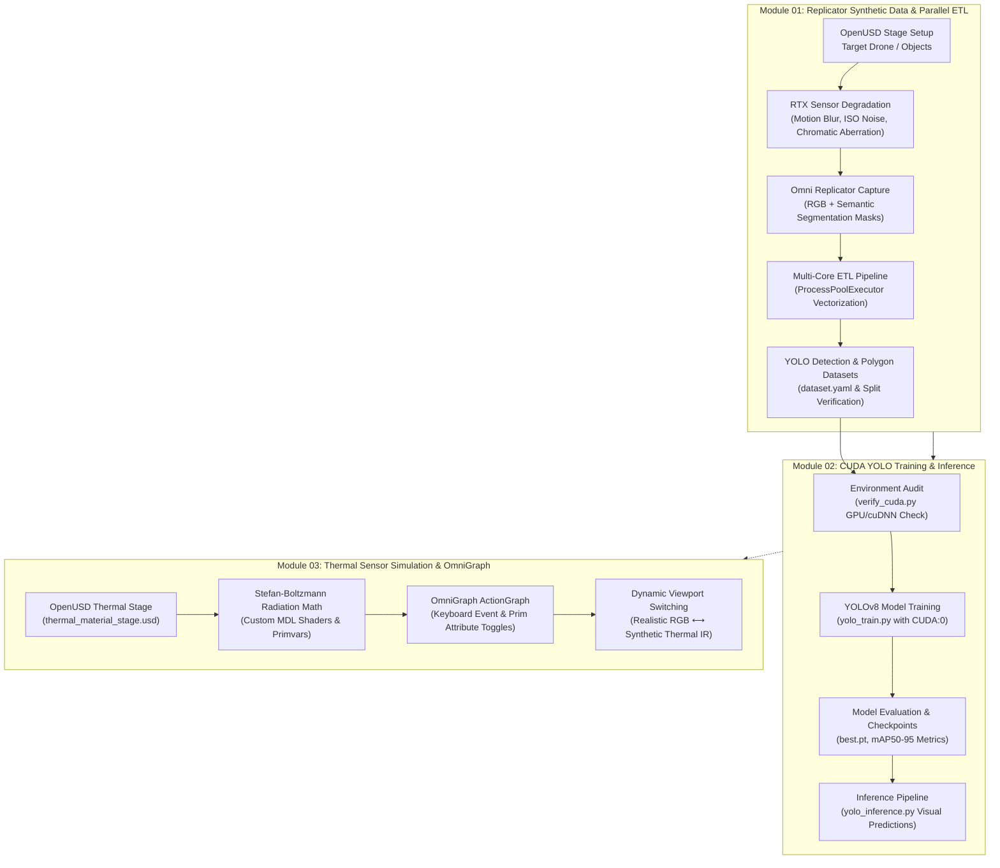

# NVIDIA Isaac Sim Synthetic Vision Lab: End-to-End Physical AI Perception Pipeline

[](https://developer.nvidia.com/isaac-sim)
[](https://openusd.org/)
[](https://pytorch.org/)
[](https://ultralytics.com/)
[](https://releases.ubuntu.com/22.04/)

An end-to-end, reproducible **Physical AI and Synthetic Perception** curriculum. This repository guides computer vision and robotics engineers through generating domain-randomized synthetic data in **NVIDIA Isaac Sim**, executing multi-core ETL transformations into YOLO formats, training CUDA-accelerated object detection models, and simulating multi-spectral (RGB vs. Thermal Long-Wave Infrared) sensor views using **OpenUSD** and **OmniGraph**.

---

## 1. Architecture & Learning Path

The laboratory curriculum is structured into three progressive, production-grade modules:



### Module Summary

| Module | Directory | Core Technologies | Primary Deliverables |
| :--- | :--- | :--- | :--- |
| **01. Synthetic Data & Parallel ETL** | [`01_replicator_synthetic_data/`](01_replicator_synthetic_data/README.md) | `omni.replicator`, `carb.settings`, OpenCV, `ProcessPoolExecutor` | Randomized synthetic image captures, bounding box/polygon segmentation ETL, dataset verifier, unified `dataset.yaml`. |
| **02. CUDA YOLO Training & Inference** | [`02_cuda_yolo_training/`](02_cuda_yolo_training/README.md) | PyTorch, CUDA, cuDNN, Ultralytics YOLOv8 | CUDA diagnostic audit, automated YOLO training pipeline, converged weights (`best.pt`), inference evaluation script. |
| **03. OpenUSD Thermal Sensor Stage** | [`03_thermal_sensor_omnigraph/`](03_thermal_sensor_omnigraph/README.md) | OpenUSD, MDL Shading, OmniGraph (ActionGraph) | Procedural thermal radiation material, temperature/emissivity primvars, dynamic RGB-to-LWIR runtime viewport toggle. |

---

## 2. System Prerequisites & Environment Matrix

### Hardware Requirements
- **GPU**: NVIDIA RTX GPU with Tensor Cores (Ada Lovelace, Ampere, or Turing architectures).
  - *Minimum*: 8 GB VRAM (sufficient for headless synthetic data capture and batch-size 16 YOLO training).
  - *Recommended*: 16 GB+ VRAM (for real-time Ray Tracing in Isaac Sim GUI and multi-stream rendering).
- **CPU**: x86_64 multi-core processor (8+ physical cores recommended for parallel ETL multi-processing).
- **RAM**: 32 GB system memory.

### Software Stack
| Component | Supported / Tested Version | Execution Runtime |
| :--- | :--- | :--- |
| **Host OS** | Ubuntu 22.04 LTS (`x86_64`) | Linux Native |
| **NVIDIA Driver** | `>= 535.129.03` (Recommended: `>= 550.x`) | Host Kernel Module |
| **NVIDIA Isaac Sim** | `4.2.0` / `5.0.0` | Isaac Sim bundled Python (`./python.sh`) |
| **Python (Host / Conda)** | `Python 3.10` | Standard ML Conda environment |
| **Deep Learning** | `torch >= 2.0.0` with `CUDA 11.8` or `12.1+` | Host / Conda |
| **Vision & ML Libraries** | `ultralytics >= 8.0.0`, `opencv-python`, `numpy` | Host / Conda |

> [!IMPORTANT]
> **Runtime Environment Separation**:
> - Scripts in `01_replicator_synthetic_data/scripts/dataset_creation/` **MUST** be executed using Isaac Sim's internal interpreter (`./python.sh` located in your Isaac Sim installation root).
> - Scripts in `01_replicator_synthetic_data/scripts/dataset_preparation_for_yolo_training/` and `02_cuda_yolo_training/scripts/` run in your standard CUDA-enabled **Python/Conda** environment.

---

## 3. Repository Structure

```text
isaac-sim-synthetic-vision-lab/
├── 01_replicator_synthetic_data/
│   ├── README.md                                # Lab 1 guide: Replicator & ETL pipeline
│   └── scripts/
│       ├── dataset_creation/
│       │   ├── replicator_noise.py              # Sensor degradation (ISO grain, motion blur, chromatic aberration)
│       │   ├── replicator_prim_onStage.py       # Camera orbit and HDRI dome randomization
│       │   └── replicator_semantic.py           # Semantic annotation tagging on USD prims
│       └── dataset_preparation_for_yolo_training/
│           ├── yolo_etl.py                      # Contour-based polygon segmentation ETL (RGB color mapping)
│           ├── yolo_etl_BB_optimized.py         # Multi-process BGR bounding-box ETL (ProcessPoolExecutor)
│           ├── python_BB_verification.py        # Visual label overlay verification tool
│           └── yolo_folders_merge_dataset.py    # Multi-class folder merger and YOLO dataset assembler
├── 02_cuda_yolo_training/
│   ├── README.md                                # Lab 2 guide: CUDA verification, training & inference
│   └── scripts/
│       ├── verify_cuda.py                       # PyTorch CUDA & cuDNN hardware diagnostics
│       ├── yolo_train.py                        # YOLOv8 training loop with validation metrics
│       └── yolo_inference.py                    # Multi-image inference with visual bounding box output
├── 03_thermal_sensor_omnigraph/
│   ├── README.md                                # Lab 3 guide: Thermal OpenUSD stage & OmniGraph
│   ├── OpenUSD stage/
│   │   └── thermal_material_stage.usd           # Stage with custom thermal MDL, primvars, & ActionGraph
│   └── image_guide/
│       ├── Screenshot from 2026-11-18 11-32-56.png # Stage baseline in RGB mode with ActionGraph
│       ├── Screenshot from 2026-11-18 11-33-02.png # Viewport toggled into simulated Thermal IR mode
│       └── Screenshot from 2026-11-18 11-33-29.png # Material Graph showing Stefan-Boltzmann radiation math
├── docs/
│   └── troubleshooting.md                       # Comprehensive triage for environment, RTX, & ETL bugs
└── README.md                                    # Root curriculum navigation (this file)
```

---

## 4. End-to-End Quickstart

### Step 1: Generate Synthetic Data in Isaac Sim
Navigate to your NVIDIA Isaac Sim installation directory and launch the synthetic data generator:
```bash
cd ~/.local/share/ov/pkg/isaac-sim-4.2.0  # Adjust to your Isaac Sim install path
./python.sh /path/to/isaac-sim-synthetic-vision-lab/01_replicator_synthetic_data/scripts/dataset_creation/replicator_noise.py
```

### Step 2: Extract & Format YOLO Dataset
Activate your ML Conda environment and run the parallelized bounding box ETL engine:
```bash
conda activate yolo_cuda
cd /path/to/isaac-sim-synthetic-vision-lab/01_replicator_synthetic_data/scripts/dataset_preparation_for_yolo_training
python yolo_etl_BB_optimized.py
python python_BB_verification.py
```

### Step 3: Validate CUDA & Train YOLO
Confirm GPU acceleration and train the perception model:
```bash
cd /path/to/isaac-sim-synthetic-vision-lab/02_cuda_yolo_training/scripts
python verify_cuda.py
python yolo_train.py
python yolo_inference.py
```

### Step 4: Explore Thermal IR Simulation in OpenUSD
Launch Isaac Sim GUI, load `03_thermal_sensor_omnigraph/OpenUSD stage/thermal_material_stage.usd`, and trigger the OmniGraph key binding to observe physical thermal emission.

---

## 5. Lab Navigation & Diagnostics

Detailed, step-by-step technical guides are maintained inside each individual module directory:

1. [**Lab 1: Replicator Synthetic Data & Parallel YOLO ETL**](01_replicator_synthetic_data/README.md)
2. [**Lab 2: CUDA-Accelerated YOLO Training & Inference**](02_cuda_yolo_training/README.md)
3. [**Lab 3: OpenUSD Thermal Sensor Stage & OmniGraph**](03_thermal_sensor_omnigraph/README.md)
4. [**Diagnostics & Common Pitfalls Guide**](docs/troubleshooting.md)
